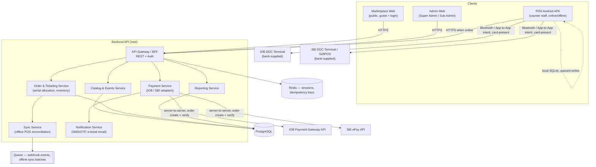

# TTDC Ticketing Platform — Technical Proposal
## Online Marketplace + Hybrid Online/Offline Android POS

**Prepared for:** TTDC Fair Ticketing
**Scope of this proposal:** Customer-facing online booking (marketplace), a counter-staff Android POS app that works both online and offline, guest + registered user identity, and payment integration with IOB and SBI (both gateway API and bank-supplied POS hardware).
**Relationship to prior work:** This supersedes and extends `payment-gateway-options.md` (which scoped SBI/Indian Bank for the existing web app only). The backend-is-mandatory finding from that memo still holds and is now the foundation this whole proposal is built on — it's no longer optional, since a marketplace and a multi-counter offline POS cannot share accurate inventory without one.

---

## 1. What's actually being asked for

Four things, which are really three new surfaces on top of one new backend:

| Surface | Who uses it | Today | What's needed |
|---|---|---|---|
| **Marketplace (web)** | General public, online, from any browser | Doesn't exist | New customer-facing booking site |
| **POS Android app (APK)** | Counter staff at the fair gate | Exists as a web page (`/counter/*`) assuming one browser, one machine, always-online `localStorage` | New native/hybrid Android app, offline-capable, talking to a real backend |
| **Admin console** | Super Admin / Sub Admin | Exists (`/sa`, `/sub`), currently `localStorage`-backed | Re-point at the same new backend; UI mostly unchanged |
| **Payments** | All of the above | Razorpay test-mode, frontend-only | IOB + SBI, two separate integration shapes (see §8) |

The current POC (events, counters, ticket categories, roles, reports) is the right **domain model** — it doesn't need to be redesigned. What it's missing is a server that more than one device can trust at the same time. That gap is why "add a marketplace" and "add offline POS" turn into the same underlying project: both are really "give this app a backend," approached from two different doors.

---

## 2. Architecture

Three clients, one backend, one database. This is the single most important structural decision in this proposal — it's what makes "revenue by event" reporting still work when tickets come from three different places, and it's what prevents the same seat/ticket serial being sold twice by a web buyer and an offline counter at the same moment.

---

## 3. User identity: guest and registered, on both surfaces

| | Guest | Registered |
|---|---|---|
| **Marketplace** | Name, phone, email collected at checkout; phone OTP-verified so the e-ticket can be delivered and the booking looked up later by phone number | Phone or email + password, or OTP-only login (no password) — common pattern for Indian consumer apps; adds order history, saved details, faster rebooking |
| **POS** | N/A — POS doesn't "log in" a visitor; the **counter employee** logs in (existing role-based auth), and the visitor's details are optional (phone number for e-ticket/receipt, not mandatory for a cash walk-up sale) | N/A |

Recommendation: **phone-number + OTP as the primary identity for the public**, with email as a secondary channel, not the primary one — matches how most Indian ticketing/booking consumer apps (IRCTC, BookMyShow, RedBus) work, and avoids forcing a password on a one-time visitor. Session tokens: JWT access token + refresh token, short-lived access token so a stolen token from a shared kiosk browser expires fast.

Counter-employee auth on the POS APK must also work **offline** — the APK needs to cache the logged-in employee's session locally so staff can keep issuing tickets through a connectivity drop without being logged out mid-shift.

---

## 4. Frontend — Marketplace (web)

- **Stack:** React + Vite (same toolchain as the existing admin app, so the Tamil Nadu heritage design system — teal `#0E6B64` / gold `#C8962C`, the typography and component patterns already built — extends directly instead of being rebuilt from scratch) or Next.js if server-rendered SEO for event landing pages is wanted (recommended if the public needs to find events via Google, not just a direct link).
- **Core flows:** browse events → pick date/category/quantity → guest or login → review → pay (IOB/SBI) → e-ticket (QR code, PDF/email/SMS) → "my bookings" lookup by phone+OTP for guests, or account history for registered users.
- **Reuses from the POC:** `QuantitySelector`, `PaymentModeSelector` patterns, the theme (`src/app/theme.ts`), i18n setup (English/Tamil) — all directly portable since they're not coupled to `localStorage`.
- **New:** public event catalog pages, cart/checkout flow, OTP verification screen, QR e-ticket renderer, "my bookings" guest lookup, responsive mobile-first layout (most walk-up online buyers at a fair will be on a phone, not a desktop).

## 5. Frontend — POS Android APK (offline-first)

This is the highest-risk new surface, because "offline" is doing real work: it means a counter must keep selling tickets through a network outage without overselling or double-issuing.

- **Platform:** Native Android (Kotlin) or React Native. React Native is the faster path if the team wants to share business logic/validation with the marketplace's React codebase; native Kotlin is the safer path if the bank's EDC SDK is Android-native-only and Bluetooth/Intent bridging needs to be rock solid (EDC SDKs are usually published as Android AARs, which React Native can wrap via a native module either way — this just changes how much glue code is written). **Recommendation: React Native with a thin native module for the EDC bridge** — reuses more of the existing team's React skillset, and the EDC bridge is a small enough surface to isolate.
- **Local data layer:** SQLite (via WatermelonDB or plain Room/SQLite) holding: the active event's ticket categories/prices (synced down when online), a write-ahead log of tickets issued while offline, and the logged-in employee's session.
- **Offline ticket issuance:** each POS device is pre-assigned a **reserved block of ticket serial numbers per event** (e.g., device A gets 1001–1500, device B gets 1501–2000) before the event goes live, so two offline devices can never allocate the same serial. Cash sales work fully offline on this model with zero payment-integration dependency.
- **Sync:** on reconnect, the device pushes its queued tickets to the Sync Service, which reconciles them into the central ledger and reports back the authoritative state (e.g., flags if a serial block is close to exhaustion, triggers an on-demand top-up).
- **Printing:** Bluetooth thermal printer, same receipt content/logic as the existing `TicketPrint.tsx`/printer settings store, ported to a native print SDK.
- **UX:** large tap targets, high-contrast outdoor-readable theme (fair gates are outdoors, often in direct sun), a persistent connectivity/sync-status indicator (counter staff need to *see* "12 tickets pending sync" at a glance, not discover it later).

## 6. Backend (new — does not exist today)

- **Stack:** Node.js (NestJS) or similar — picked to match the team's existing TypeScript investment in the frontend, so types can be shared between backend and both web clients.
- **Database:** PostgreSQL (relational integrity matters here — ticket serials, payment status, and revenue reports must never drift) + Redis for session/cache/idempotency keys + a queue (SQS/BullMQ/RabbitMQ) for webhook events and offline-sync batches.
- **Services** (can start as modules in one deployable and be split later — no need to build microservices on day one):
  - **Catalog & Events** — events, cities, ticket categories/prices (the existing data model, now server-owned).
  - **Order & Ticketing** — the inventory/serial-allocation authority; every ticket, from any channel, is issued through this service.
  - **Payment** — one adapter per bank (§8), a single internal interface (`createOrder`, `verifyPayment`, `refund`) so the rest of the system doesn't care which bank is behind it.
  - **Sync** — reconciles offline POS batches, detects and reports conflicts (should be near-impossible by construction given serial blocks, but still needs auditing).
  - **Reporting** — the existing report logic (`eventSummary`, `counterSummary`, GST) rebuilt against the real database instead of scanning `localStorage`.
  - **Notification** — SMS OTP, e-ticket delivery (email/SMS with QR).
- **Auth:** JWT, role-aware (the existing `SUPER_ADMIN` / `SUB_ADMIN` / `COUNTER_EMPLOYEE` roles carry over unchanged, plus a new unprivileged `CUSTOMER` identity for the marketplace).

## 7. Data model: what changes from the current POC

The existing types (`Event`, `TicketCategory`, `User`, ticket/order records) are the right shape and move over conceptually unchanged. What's added:

- `Order` becomes an explicit entity distinct from `Ticket` (one order can contain multiple tickets/categories; today's mock model conflates them).
- `channel` field on every order: `MARKETPLACE_ONLINE | POS_ONLINE | POS_OFFLINE_SYNCED` — this is what makes "which counter/admin collected how much cash" reporting (the very first feature built in this project) keep working once there are three sources of truth instead of one.
- `Customer` entity (guest or registered) replaces the implicit "no customer record" of the counter-only model.
- Per-device **serial block allocation** table for offline POS.
- `PaymentInfo` generalizes beyond the current Razorpay-shaped `razorpayPaymentId`/`razorpayOrderId` pair to a bank-agnostic `{ provider, providerOrderId, providerPaymentRef, status }`.

## 8. Payment integration — IOB and SBI

Two genuinely different integration shapes live under "payment," and the proposal keeps them separate on purpose:

### 8a. Marketplace — server-to-server gateway API (card-not-present)

Same pattern already documented for SBI in `payment-gateway-options.md`, now also needed for IOB: backend creates an order with the bank using a merchant key that never reaches the browser, customer pays on the bank's hosted page/widget, bank calls the backend back with a signed/checksummed result, backend independently re-verifies status before marking the order paid. **IOB's public developer documentation was not found during this research** — Indian Overseas Bank publishes a POS FAQ page but no public merchant-API/SDK portal, which mirrors what was already found for Indian Bank. This has to be requested directly through IOB's relationship manager once a merchant account is opened; treat the integration doc as available-on-request, not public.

### 8b. POS APK — card-present, via bank-supplied terminal

This is new scope beyond the earlier memo. Two likely shapes, both of which avoid card data ever touching our app or servers (which keeps PCI-DSS scope minimal for TTDC):

1. **App-to-App / Intent bridge** — our POS app sends an Android Intent with the amount + reference to the bank's own payment app running on the same Android EDC terminal; the bank's app handles the card tap/insert/PIN entirely; our app gets back a result broadcast with status + reference number. This is the industry-standard pattern (used by Pine Labs, PayU, and similar Android POS SDKs) and is the most likely shape for both IOB and SBI's EDC terminals.
2. **SoftPOS** — SBI has a tap-on-phone product that turns an NFC Android phone into an acceptance device via a dedicated app; if TTDC's banking relationship goes this route instead of dedicated EDC hardware, the integration is similar (App-to-App) but on the same consumer-grade device the POS app already runs on, which is operationally simpler (one device per counter, not two).

**Neither bank publishes this SDK publicly.** Confirm with each bank, once terminals are allocated, which exact shape applies — this determines whether the Android team builds a Bluetooth-pairing flow (separate physical terminal) or an Intent-bridge flow (software-only, same device).

### 8c. Fallback for day one

If a bank's integration isn't ready by the marketplace/POS launch date, cash-only POS and a UPI QR code displayed at the counter are both zero-integration fallbacks that keep ticketing operational while the bank-specific work finishes in parallel — worth sequencing this way regardless, since both banks' onboarding timelines are external dependencies outside the dev team's control.

### 8d. Side-by-side

| | IOB | SBI |
|---|---|---|
| Govt/PSU merchant fit | Expected yes, not confirmed publicly | Confirmed, relaxed eligibility for govt/PSU |
| Online gateway API docs | Not public — request via RM | Issued at onboarding (not public) |
| POS/EDC integration | Not public — request via RM | Likely App-to-App; SoftPOS alternative exists |
| Fees/settlement | Not published | Not published |

---

## 9. Design (UX/UI)

Both new surfaces extend the design system already built for the admin app, not a new one:

- **Marketplace:** consumer-grade, mobile-first, same teal/gold Tamil Nadu heritage palette and light/dark theming already shipped, applied to a browsing/checkout flow instead of an admin table/form flow. Accessibility matters more here than in the admin app — this is the public, on a huge range of devices.
- **POS APK:** optimized for speed-of-sale and outdoor legibility over visual richness — large touch targets, high contrast, a persistent sync-status affordance, minimal steps from "visitor at counter" to "ticket printed."
- Both pull from the same icon/typography/spacing tokens as the admin app so the whole product family reads as one system, not three unrelated apps.

## 10. Testing strategy

| Layer | Approach |
|---|---|
| Backend unit/integration | Jest + Supertest; contract tests against mocked IOB/SBI webhook payloads so payment-adapter logic is verifiable without live bank sandboxes |
| Marketplace E2E | Playwright — guest checkout, registered checkout, payment success/failure/timeout, OTP flow |
| POS APK UI | Espresso/Appium |
| **Offline-mode matrix** (POS-specific, the highest-risk area) | Explicit test scenarios: issue tickets with no connectivity, kill the app mid-offline-queue, reconnect and verify sync with zero duplicate/lost tickets, exhaust a device's serial block mid-event, two devices syncing simultaneously |
| Payment UAT | Run the full flow against each bank's sandbox/UAT environment once credentials are issued, before requesting production go-live access |
| Load/concurrency | Simulate peak-day concurrent marketplace checkouts against the same event/category to confirm inventory never oversells |
| Security | OWASP Top 10 review on the new backend; confirm card data never transits our servers/app (keeps PCI scope minimal); a penetration test before go-live, since this now handles public money for a government client |

---

## 11. Non-functional requirements

- **Security:** JWT with short-lived access tokens, OTP rate-limiting, bank webhook signature verification, no card data at rest anywhere in TTDC's systems.
- **Availability:** marketplace and backend should target standard web-service uptime (managed hosting, health checks, basic autoscaling for fair-day traffic spikes); POS APK's offline mode is the resilience strategy for the counter specifically.
- **Data residency:** RBI rules require Indian payment data to stay in India — standard for any India-hosted deployment, worth confirming explicitly with the hosting provider.
- **Auditability:** every ticket must carry enough metadata (channel, device, employee, payment provider+reference) to reconstruct "who collected what, from where" — a requirement this project already had from its very first feature request, and it gets more important, not less, with three issuance channels.

## 12. Phased delivery

| Phase | Deliverable | Depends on |
|---|---|---|
| 0 | Backend foundation: auth, Postgres schema, Catalog + Order services; admin app re-pointed at it instead of `localStorage` | — |
| 1 | Marketplace MVP: browse → guest checkout → one bank's online payment → e-ticket | Phase 0 |
| 2 | POS APK v1: **online-only**, feature parity with today's web counter flow, bank EDC integration (App-to-App) | Phase 0 |
| 3 | POS offline mode: local DB, serial-block allocation, sync engine, offline test matrix | Phase 2 |
| 4 | Registered-user accounts + order history; second bank integrated; full security/load testing; bank UAT sign-off; go-live | Phases 1–3 |

Phases 1 and 2 can run in parallel once Phase 0 lands — they're independent clients against the same backend.

## 13. Open questions only TTDC (and the banks) can answer

1. Does TTDC's POS hardware come from IOB, SBI, or both, and has either bank already named which EDC model/terminal will be deployed?
2. Is SBI's SoftPOS (phone-as-terminal) viable for TTDC's counters, or is dedicated EDC hardware mandatory per the banking relationship?
3. What's the real connectivity situation at the fairground gates — is it "no signal at all" or "slow/unreliable," since that changes how aggressively the POS app needs to assume offline vs. just tolerate retries?
4. Is a go-live date already fixed? Both banks' onboarding (document checklist, terminal deployment, SDK handoff) are external-timeline dependencies, same as noted in the earlier payment memo.
5. Does TTDC want native Android only, or does an iOS counter app ever become a requirement (changes the React Native vs. native Kotlin call in §5)?

---

### Sources

- [Indian Bank — Point of Sale (POS)](https://indianbank.bank.in/en/point-of-sale-pos)
- [IOB — FAQ on POS](https://www.iob.bank.in/en/faq-on-pos)
- [Fiserv — Android POS Machine (India)](https://merchants.fiserv.com/india/in-store/android-terminals/)
- [PayU — APIs for Android POS SDK Integration](https://docs.payu.in/docs/apis-for-android-pos-sdk-integration)
- [Pine Labs — App-to-App Billing Integration](https://developer.pinelabs.com/in/instore/app-integration)
- [SBI — smartphones as PoS machines via mobile app (SoftPOS)](https://zeenews.india.com/personal-finance/good-news-for-sbi-customers-merchants-can-turn-their-smartphones-into-pos-machine-through-a-simple-mobile-app-2343742.html)
- Prior internal research: `docs/payment-gateway-options.md` (SBI ePay / Indian Bank IB Collect, online-only scope)
